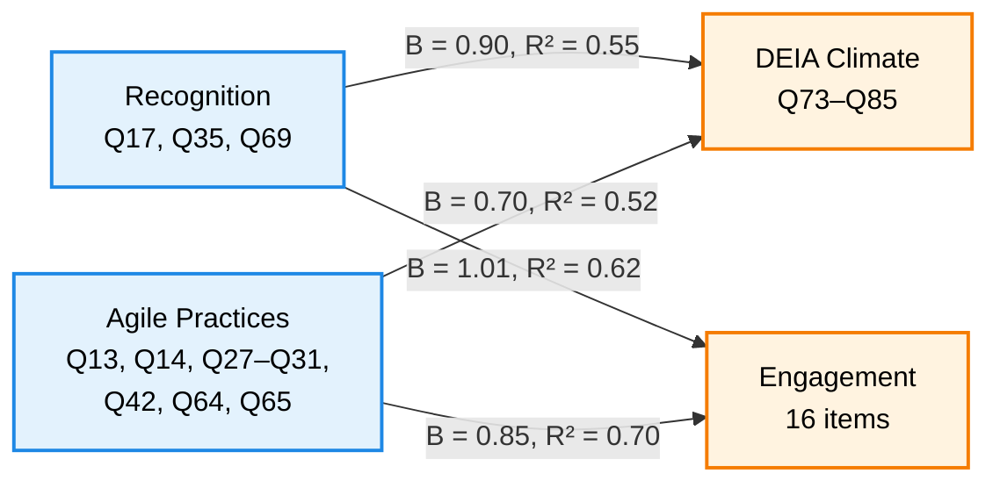

# DEIA, Recognition, and Engagement at the NSF

A regression analysis of National Science Foundation employees, using the 2023 Federal Employee Viewpoint Survey (FEVS).

## The question

Federal agencies invest in recognition programs and agile project management. Do either of them relate to how employees perceive DEIA and how engaged they report being?

## The model

## The data

2023 FEVS public use file, filtered to Agency = NF (National Science Foundation). n = 1,070 before model missingness; n = 1,040 in the controlled regressions.

All four composite indices follow OPM's published index definitions (see `OPM Codebook Open in Excel.xlsx`). We did not invent new composite groupings.

| Variable | Items | Source |
|---|---|---|
| Recognition | Q17, Q35, Q69 | "Goal Oriented: Recognition" index |
| DEIA | Q73–Q85 | "DEIA Index — Overall" |
| Agile | Q13, Q14, Q27–Q31, Q42, Q64, Q65 | "Agile: Overall" |
| Engagement | Q2, Q3, Q4, Q6, Q7, Q48, Q50, Q51, Q52, Q54, Q57, Q58, Q59, Q61, Q62 | "Employee Engagement Index — Overall" |

Race and Sex are derived from DRNO and DSEX, with "did not report" retained as its own category.

## Findings

| Model | Coefficient | R² | N |
|---|---|---|---|
| Recognition ~ DEIA + Race + Sex | B = 0.896 (t = 34.4) | 0.55 | 1,040 |
| Agile ~ DEIA + Race + Sex | B = 0.697 (t = 32.5) | 0.52 | 1,040 |
| Recognition ~ Engagement | B = 1.01 (t = 42.0) | 0.62 | 1,066 |
| Agile ~ Engagement | B = 0.847 (t = 49.8) | 0.70 | 1,070 |

All p < 0.001.

## This analysis shows / does not show

| Shows | Does not show |
|---|---|
| Recognition and DEIA perceptions move together at NSF (B = 0.90) | That recognition causes inclusion |
| Agile practices and DEIA perceptions move together (B = 0.70) | That agile adoption increases inclusion |
| Recognition explains 62% of variance in engagement | Which variable moves first |
| Effects hold after controlling for race and sex | Whether the same patterns exist at other agencies |

## Limitations

- **Cross-sectional.** No causal claims. The data show that these perceptions move together; they do not show what moves first.
- **Self-report on both sides.** Recognition, DEIA, Agile, and Engagement are all employee perceptions. Some of the correlation is likely common-method variance.
- **Single agency.** NSF only. Not generalizable to other federal agencies or the private sector.
- **Q73–Q85 measures perceived DEIA commitment,** not demographic composition. The index name is OPM's.
- **Specification note.** The original hypothesis was "recognition affects DEIA," but the model tested `Recognition ~ DEIA`. A follow-up analysis would test both directions; the current repo does not.

## What I'd do differently

Test the reverse direction explicitly. A pre/post design around an actual recognition program rollout would be the cleanest way to answer the causal question.

## How to reproduce this analysis

1. Download the 2023 FEVS public use file from [opm.gov/fevs](https://www.opm.gov/fevs/).
2. Filter to `AGENCY == "NF"` (National Science Foundation). This yields the 1,070 responses used here.
3. Convert "X" (Do Not Know) and "Y" (I do not have accessibility needs) to `NA`.
4. Open `Project Code.qmd` in RStudio. Update the `read.csv()` path at the top to point to your filtered file.
5. Knit the file to reproduce the regression tables and plots.

The raw data is not included in this repo due to file size and privacy guidelines.

## My role

I took the lead on this project. I built the composite indices from the raw OPM items, wrote the R code for cleaning and modeling, and drafted the final report and recommendations. My teammates contributed to the literature review and the final presentation.

## Data dictionary

The full OPM codebook, mapping each question (Q1–Q91) to its survey text and index grouping, is available in the repository as `OPM Codebook Open in Excel.xlsx`.
